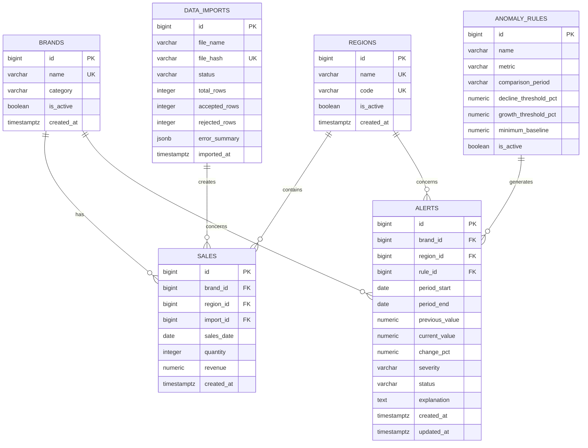
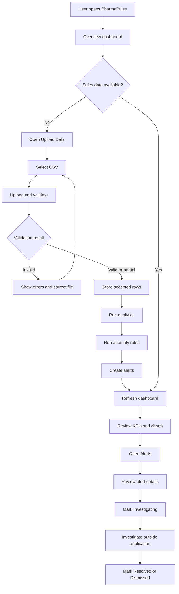

# PharmaPulse – Healthcare Sales Intelligence
## Complete Product, Architecture, and Agent-Driven Development Plan

**POC target:** 7 days | **Complexity:** Medium | **Domain:** Healthcare/pharmaceutical sales  
**Stack:** React + Vite, FastAPI, PostgreSQL, SQLAlchemy, Alembic, Pandas, Recharts

---

# 1. Executive summary

PharmaPulse is an independent pharmaceutical sales intelligence application. It helps business teams review sales across drug brands and regions, identify unusual changes, and prioritize areas that need investigation.

**Core workflow:** Upload CSV → validate records → store sales data → calculate analytics → detect unusual changes → generate alerts → review insights in the dashboard.

Use synthetic or explicitly approved, de-identified sales data for this POC. Do not connect to a production KAM system or use patient data.

**POC success criteria**
- Upload and validate a CSV file.
- Store valid records in PostgreSQL.
- Display revenue, units, brand performance, regional performance, and monthly trends.
- Detect configured sales changes and create explainable alerts.
- Filter analytics and update alert status.
- Run locally using documented setup instructions.

# 2. What is the application, why build it, and who uses it?

## 2.1 What is PharmaPulse?

A web-based business intelligence platform that turns structured pharmaceutical sales data into useful metrics, comparisons, and investigation alerts.

It answers:
- Which drug brand generated the highest revenue?
- Which brand or region is growing or declining?
- How have sales changed month over month?
- Which brand-region combinations crossed a configured alert threshold?
- Which alerts are open, under investigation, or resolved?

## 2.2 Why build it?

Sales information can be spread across spreadsheets and business systems. Teams may spend time consolidating reports and manually identifying unusual changes. PharmaPulse provides a repeatable process for data ingestion, validation, analytics, and alert review.

It helps teams:
- Consolidate sales data.
- Reduce manual spreadsheet comparisons.
- See performance by brand, region, and period.
- Surface unusual movements for investigation.
- Use consistent calculations and alert rules.

An alert is a signal for investigation, not proof of the cause. Do not claim that a decline was caused by stock shortages or representative performance unless the relevant evidence exists.

## 2.3 Intended users

| User | Responsibility | Application value |
|---|---|---|
| Sales Manager | Monitor overall sales | Company/region KPIs and high-priority alerts |
| Regional Manager | Review territory performance | Region filters, brand trends, investigation queue |
| Business Analyst | Explore and explain data | Filters, detailed tables, import validation |
| Administrator | Maintain application data | Brand/region master data, imports, thresholds |

For the one-week POC, prioritize the business workflow. Complex authentication and role-based permissions can be future work. Do not imply that UI filters enforce security.

## 2.4 Out of scope

Not a clinical decision-support tool, patient record system, prescription system, inventory platform, KAM replacement, or automated root-cause diagnosis system.

# 3. Product scope and requirements

## Functional requirements

**FR-01: CSV upload**
- Accept CSV files.
- Enforce file-size limits.
- Validate headers and row values.
- Show accepted/rejected counts and row-level errors.
- Detect duplicate uploads.

**FR-02: Master data**
- Maintain drug brands and regions.
- Match uploaded names to master records.
- Report unknown names instead of silently creating inconsistent records.

**FR-03: Analytics**
- Total revenue and units.
- Brand-wise and region-wise performance.
- Monthly trends.
- Period-over-period change.
- Date, brand, and region filters.

**FR-04: Anomaly detection**
- Compare equivalent periods.
- Apply configurable decline/growth thresholds.
- Skip zero or insufficient baselines.
- Avoid duplicate alerts.

**FR-05: Alert management**
- List and filter alerts.
- Display severity and comparison values.
- Update status: Open, Investigating, Resolved, Dismissed.

**FR-06: Dashboard**
- KPI cards, charts, tables, filters.
- Loading, empty, and error states.
- Display selected date range and last import time.

## Non-functional requirements
- Thin API routers; business logic in services.
- Pydantic request/response validation.
- Database constraints and indexes.
- UTC timestamps; local-time display.
- Pagination for lists.
- Secrets only in environment configuration.
- No patient data, credentials, or unnecessary sensitive payload logging.
- Configurable thresholds.
- Clear setup and demo documentation.

# 4. Complete application architecture

## 4.1 Logical architecture

```text
+-------------------------------+
| End users                     |
| Sales Manager / Analyst       |
+---------------+---------------+
                |
                v
+-------------------------------+
| React + Vite                  |
| Overview | Upload | Alerts    |
| Analytics | Import History    |
+---------------+---------------+
                |
          REST / JSON
                |
                v
+-------------------------------+
| FastAPI                       |
| API routers and schemas       |
+---------------+---------------+
                |
                v
+-------------------------------+
| Application services          |
| Import and validation         |
| Sales analytics               |
| Anomaly detection             |
| Alert management              |
+---------------+---------------+
                |
                v
+-------------------------------+
| SQLAlchemy data access        |
+---------------+---------------+
                |
                v
+-------------------------------+
| PostgreSQL                    |
| Brands, Regions, Sales        |
| Imports, Rules, Alerts        |
+-------------------------------+
```

## 4.2 Data processing flow

```text
CSV file
  -> Upload API
  -> File/schema validation
  -> Row validation
  -> Normalize names, dates and numbers
  -> PostgreSQL transaction
  -> Analytics aggregation
  -> Anomaly rules engine
  -> Alert records
  -> Dashboard and alert APIs
  -> React charts and tables
```

## 4.3 Backend request flow

1. Router receives request.
2. Pydantic validates parameters.
3. Service executes business logic.
4. Repository/data-access layer queries the database.
5. SQLAlchemy manages persistence.
6. Router returns a typed response model.

Avoid placing all SQL and business logic inside route functions.

## 4.4 Local POC deployment

```text
Developer machine
  frontend: http://localhost:5173
  backend:  http://localhost:8000
  postgres: localhost:5432
```

Use `.env` for local secrets and commit only `.env.example`.

# 5. Technology stack

| Layer | Technology | Purpose |
|---|---|---|
| Frontend | React + Vite | UI and development server |
| Routing | React Router | Page navigation |
| HTTP | Axios | Backend requests |
| Styling | CSS or Tailwind CSS | Responsive UI |
| Charts | Recharts | Analytics visualizations |
| Icons | Lucide React | UI icons |
| Backend | FastAPI | REST APIs |
| Validation | Pydantic | Typed request/response schemas |
| ORM | SQLAlchemy 2.x | Database mapping |
| Migrations | Alembic | Versioned schema changes |
| Database | PostgreSQL | Relational storage |
| Data processing | Pandas | CSV parsing and data preparation |
| Detection | Python statistical rules | Explainable anomaly logic |
| Testing | Pytest + HTTPX | Backend and API tests |
| API docs | OpenAPI / Swagger | Interactive documentation |
| Version control | Git | Source control |

Backend dependencies:

```text
fastapi
uvicorn[standard]
pydantic-settings
sqlalchemy
psycopg[binary]
alembic
pandas
python-multipart
httpx
pytest
```

Frontend:

```bash
npm install axios react-router-dom recharts lucide-react
```

Pin compatible dependency versions once the environment is stable.

# 6. Project folder structure

```text
pharmapulse/
├── backend/
│   ├── app/
│   │   ├── main.py
│   │   ├── api/
│   │   │   ├── deps.py
│   │   │   └── v1/
│   │   │       ├── router.py
│   │   │       └── endpoints/
│   │   │           ├── health.py
│   │   │           ├── imports.py
│   │   │           ├── dashboard.py
│   │   │           ├── sales.py
│   │   │           ├── alerts.py
│   │   │           ├── brands.py
│   │   │           └── regions.py
│   │   ├── core/
│   │   │   ├── config.py
│   │   │   └── logging.py
│   │   ├── database/
│   │   │   ├── session.py
│   │   │   └── base.py
│   │   ├── models/
│   │   │   ├── brand.py
│   │   │   ├── region.py
│   │   │   ├── sales.py
│   │   │   ├── data_import.py
│   │   │   ├── alert.py
│   │   │   └── anomaly_rule.py
│   │   ├── schemas/
│   │   │   ├── import_schema.py
│   │   │   ├── dashboard_schema.py
│   │   │   ├── sales_schema.py
│   │   │   └── alert_schema.py
│   │   ├── services/
│   │   │   ├── import_service.py
│   │   │   ├── validation_service.py
│   │   │   ├── analytics_service.py
│   │   │   ├── anomaly_service.py
│   │   │   └── alert_service.py
│   │   ├── repositories/
│   │   │   ├── sales_repository.py
│   │   │   └── alert_repository.py
│   │   └── utils/
│   │       ├── csv_utils.py
│   │       └── date_utils.py
│   ├── alembic/
│   ├── tests/
│   ├── .env.example
│   ├── alembic.ini
│   └── requirements.txt
├── frontend/
│   ├── src/
│   │   ├── main.jsx
│   │   ├── App.jsx
│   │   ├── app/router.jsx
│   │   ├── components/
│   │   │   ├── layout/
│   │   │   ├── common/
│   │   │   ├── dashboard/
│   │   │   └── alerts/
│   │   ├── pages/
│   │   │   ├── DashboardPage.jsx
│   │   │   ├── UploadPage.jsx
│   │   │   ├── AlertsPage.jsx
│   │   │   ├── SalesPage.jsx
│   │   │   └── ImportHistoryPage.jsx
│   │   ├── services/
│   │   │   ├── apiClient.js
│   │   │   ├── dashboardService.js
│   │   │   ├── importService.js
│   │   │   └── alertService.js
│   │   ├── hooks/
│   │   └── utils/
│   └── .env.example
├── sample-data/
│   └── pharma_sales_sample.csv
├── docs/
│   ├── architecture.md
│   ├── api-specification.md
│   └── demo-script.md
├── .gitignore
└── README.md
```

Create folders as they are needed; avoid unnecessary empty scaffolding.

# 7. PostgreSQL schema and relationships

## 7.1 Entity relationship diagram



## 7.2 Table definitions

### `brands`
- `id BIGINT PRIMARY KEY`
- `name VARCHAR(120) NOT NULL UNIQUE`
- `category VARCHAR(100) NULL`
- `is_active BOOLEAN NOT NULL DEFAULT TRUE`
- `created_at TIMESTAMPTZ NOT NULL`

### `regions`
- `id BIGINT PRIMARY KEY`
- `name VARCHAR(120) NOT NULL UNIQUE`
- `code VARCHAR(30) UNIQUE`
- `is_active BOOLEAN NOT NULL DEFAULT TRUE`
- `created_at TIMESTAMPTZ NOT NULL`

### `data_imports`
- `id BIGINT PRIMARY KEY`
- `file_name VARCHAR(255) NOT NULL`
- `file_hash VARCHAR(64) UNIQUE`
- `status VARCHAR(30) NOT NULL`
- `total_rows INTEGER NOT NULL DEFAULT 0`
- `accepted_rows INTEGER NOT NULL DEFAULT 0`
- `rejected_rows INTEGER NOT NULL DEFAULT 0`
- `error_summary JSONB`
- `imported_at TIMESTAMPTZ NOT NULL`

Statuses: `PROCESSING`, `COMPLETED`, `COMPLETED_WITH_ERRORS`, `FAILED`.

### `sales`
- `id BIGINT PRIMARY KEY`
- `brand_id BIGINT NOT NULL REFERENCES brands(id)`
- `region_id BIGINT NOT NULL REFERENCES regions(id)`
- `import_id BIGINT NOT NULL REFERENCES data_imports(id)`
- `sales_date DATE NOT NULL`
- `quantity INTEGER NOT NULL CHECK (quantity >= 0)`
- `revenue NUMERIC(14,2) NOT NULL CHECK (revenue >= 0)`
- `created_at TIMESTAMPTZ NOT NULL`

Define the uniqueness rule based on the source data grain. A candidate is `(brand_id, region_id, sales_date, import_id)` only if one row per combination per import is guaranteed. If multiple transactions are legitimate, preserve them or aggregate according to an explicit import contract.

### `anomaly_rules`
- `id BIGINT PRIMARY KEY`
- `name VARCHAR(120) NOT NULL`
- `metric VARCHAR(40) NOT NULL`
- `comparison_period VARCHAR(30) NOT NULL`
- `decline_threshold_pct NUMERIC(7,2) NOT NULL`
- `growth_threshold_pct NUMERIC(7,2) NOT NULL`
- `minimum_baseline NUMERIC(14,2) NOT NULL`
- `is_active BOOLEAN NOT NULL DEFAULT TRUE`
- `created_at TIMESTAMPTZ NOT NULL`

### `alerts`
- `id BIGINT PRIMARY KEY`
- `brand_id BIGINT NOT NULL REFERENCES brands(id)`
- `region_id BIGINT NOT NULL REFERENCES regions(id)`
- `rule_id BIGINT NOT NULL REFERENCES anomaly_rules(id)`
- `period_start DATE NOT NULL`
- `period_end DATE NOT NULL`
- `metric VARCHAR(40) NOT NULL`
- `previous_value NUMERIC(14,2) NOT NULL`
- `current_value NUMERIC(14,2) NOT NULL`
- `change_pct NUMERIC(8,2) NOT NULL`
- `severity VARCHAR(20) NOT NULL`
- `status VARCHAR(30) NOT NULL`
- `explanation TEXT NOT NULL`
- `created_at TIMESTAMPTZ NOT NULL`
- `updated_at TIMESTAMPTZ NOT NULL`

Severity: `LOW`, `MEDIUM`, `HIGH`. Status: `OPEN`, `INVESTIGATING`, `RESOLVED`, `DISMISSED`.

Use a deterministic alert fingerprint or unique constraint based on rule, brand, region, and period to prevent duplicate alerts.

## 7.3 Relationship summary

- One brand has many sales rows.
- One region has many sales rows.
- One import creates many sales rows.
- One brand can be referenced by many alerts.
- One region can be referenced by many alerts.
- One anomaly rule can generate many alerts.

## 7.4 Indexes

Create indexes on:
- `sales(sales_date)`
- `sales(brand_id, sales_date)`
- `sales(region_id, sales_date)`
- `sales(brand_id, region_id, sales_date)`
- `alerts(status, created_at)`
- `alerts(severity, created_at)`
- `data_imports(imported_at)`

Use Alembic migrations rather than relying on `create_all()` as the schema management strategy.

# 8. CSV data contract

Required headers:

```csv
sales_date,brand_name,region_name,quantity,revenue
2026-01-01,Brand A,Chennai,1200,240000.00
2026-01-01,Brand B,Coimbatore,850,170000.00
2026-02-01,Brand A,Chennai,1150,230000.00
2026-02-01,Brand B,Coimbatore,900,180000.00
```

Generate 6–12 months of synthetic data for five fictional brands and several fictional regions. Insert a few deliberate drops and spikes to demonstrate alerts.

Validation:
- Required headers exist.
- Date is valid.
- Brand and region names are non-empty and known.
- Quantity is a non-negative integer.
- Revenue is a non-negative decimal.
- File is within configured size limit.
- Duplicate upload is detected.
- Import result reports accepted and rejected rows.

Partial acceptance is suitable for the POC, provided the UI clearly explains it. Never count rejected rows as imported.

# 9. API endpoint specifications

Base path: `/api/v1`. Use Pydantic response models, ISO dates (`YYYY-MM-DD`), decimal currency values, pagination, and appropriate HTTP status codes.

## Health
`GET /health`  
Returns application health. Optionally add a separate database readiness check.

Example:
```json
{"status":"healthy","application":"PharmaPulse"}
```

## Master data
- `GET /brands` – list brands; optional `active_only`.
- `GET /regions` – list regions.
- Optional `POST /brands` and `POST /regions` if master data must be maintained through the UI. Otherwise seed master data with a script.

Example:
```json
{"items":[{"id":1,"name":"Brand A","category":"Fictional category"}],"total":1}
```

## Imports
`POST /imports` – multipart form field `file`; validate and import CSV.

Example:
```json
{
  "import_id": 12,
  "status": "COMPLETED_WITH_ERRORS",
  "file_name": "sales.csv",
  "total_rows": 100,
  "accepted_rows": 96,
  "rejected_rows": 4,
  "errors": [
    {"row_number": 8, "field": "sales_date", "message": "Invalid date"}
  ]
}
```

- `GET /imports` – paginated import history.
- `GET /imports/{import_id}` – import summary and validation details.

## Dashboard
`GET /dashboard/summary`
Parameters: `start_date`, `end_date`, optional `brand_id`, `region_id`.

Example:
```json
{
  "total_revenue": 1250000.00,
  "total_units": 8400,
  "brand_count": 5,
  "region_count": 4,
  "revenue_change_pct": 8.4,
  "currency": "INR"
}
```

- `GET /dashboard/sales-trend` – date-bucketed revenue and units.
- `GET /dashboard/brand-performance` – brand revenue, units, change.
- `GET /dashboard/region-performance` – region revenue, units, change.

Return null for percentage change if a meaningful previous-period baseline is unavailable.

## Sales
`GET /sales`
Parameters: `start_date`, `end_date`, `brand_id`, `region_id`, `page`, `page_size`. Return filtered, paginated records.

## Alerts
- `GET /alerts` – filters: `status`, `severity`, `brand_id`, `region_id`, dates, pagination.
- `GET /alerts/{alert_id}` – full details and comparison values.
- `PATCH /alerts/{alert_id}` – update status.
- `POST /alerts/run-detection` – manually run detection for a selected period in the POC; protect this operation if authentication is introduced.

Status update request:
```json
{"status":"INVESTIGATING"}
```

Detection response:
```json
{"evaluated_combinations":20,"alerts_created":2,"alerts_updated":0}
```

Use `400` for invalid query input, `404` for missing records, `409` for conflicts, and `422` for schema validation where appropriate. Never expose stack traces or database credentials.

# 10. Anomaly detection logic

Start with explainable statistical rules, not a complex ML model.

For each brand-region combination:
1. Aggregate revenue by month.
2. Select current month and equivalent previous month.
3. Check that previous revenue meets a minimum baseline.
4. Calculate percentage change.
5. Compare with configured thresholds.
6. Create an alert if a threshold is crossed.
7. Prevent duplicate alerts for the same rule and period.

Formula:

```text
change_pct = ((current_value - previous_value) / previous_value) * 100
```

Illustrative defaults:
- Revenue decline of 20% or more: HIGH.
- Revenue increase of 30% or more: MEDIUM.
- Zero or insufficient baseline: skip detection.

These are demo thresholds, not validated business rules. Confirm thresholds with stakeholders before operational use.

Example calculation:
- Previous revenue: ₹480,000
- Current revenue: ₹320,000
- Change: -33.33%
- If configured decline threshold is 20%, generate a decline alert.

Handle zero baseline, missing months, incomplete periods, duplicate imports, multiple legitimate rows, seasonality, and corrected imports. Every alert explanation must state the actual values and threshold. Never invent a cause.

Example explanation:
“Revenue for Brand A in Chennai changed from ₹480,000 to ₹320,000, a decrease of 33.33%. This crossed the configured decline threshold of 20%.”

# 11. React dashboard design

## 11.1 Navigation
- Overview
- Sales Analytics
- Alerts
- Upload Data
- Import History
- Settings (optional)

## 11.2 Overview wireframe

```text
+-------------------------------------------------------------+
| PharmaPulse                         Date Range       User   |
+-------------------+-----------------------------------------+
| Overview          | Dashboard                               |
| Sales Analytics   |                                         |
| Alerts            | [Revenue] [Units] [Brands] [Regions]    |
| Upload Data       |                                         |
| Import History    | [Monthly Sales Trend Chart]             |
|                   |                                         |
|                   | [Brand Performance] [Region Performance]|
|                   |                                         |
|                   | [Recent High-Priority Alerts]           |
+-------------------+-----------------------------------------+
```

## 11.3 Page requirements

**Overview**
- KPI cards: total revenue, units, active brands, regions.
- Revenue trend line chart.
- Brand performance bar chart.
- Region performance chart.
- Recent alerts table.
- Last successful import and selected date range.

**Sales Analytics**
- Date, brand, and region filters.
- Trend chart.
- Brand and region comparison tables.
- Paginated sales detail table.

**Upload Data**
- CSV file picker/drag-drop.
- Required column guidance and sample format.
- Upload progress.
- Validation summary and row errors.
- Link to import history.

**Alerts**
- Counts by severity and status.
- Filters.
- Paginated table.
- Detail panel with previous/current values, change, rule threshold, and factual explanation.
- Status update control.

**Import History**
- File name, date, status, row counts.
- Import detail and validation errors.

## 11.4 UI behavior
- Label charts and axes; include tooltips.
- Format currency consistently as INR.
- Show signed percentage changes.
- Do not rely on color alone for severity.
- Include loading, empty, and error states.
- Filters must affect all relevant components.
- Do not claim data is real-time; show its period and last import time.

# 12. User flows

## 12.1 Primary workflow



## 12.2 Sales manager
1. Open Overview.
2. Select a date range.
3. Review revenue and growth.
4. Compare brands and regions.
5. Open high-priority alerts.
6. Review comparison values and explanation.
7. Coordinate investigation outside the POC if assignment is not implemented.

## 12.3 Business analyst
1. Upload a sales CSV.
2. Review validation results.
3. Open Sales Analytics.
4. Filter by brand, region, and date.
5. Compare trends and prepare a business summary.

## 12.4 Regional manager
1. Filter analytics to a region.
2. Compare brand performance.
3. Review regional alerts.
4. Update alert status after investigation.

The POC's filters are not access-control boundaries. Enforce regional permissions on the backend in a later authenticated release.

# 13. Agent-driven implementation prompts

## How to use the prompts
Give a coding agent one task at a time, with the repository attached. Require it to inspect existing code first. After each task, review changed files, run commands/tests, inspect outputs, and commit a working checkpoint. Do not ask an agent to build everything in one prompt.

### Global instruction to prepend to every task

```text
You are a senior full-stack engineer building PharmaPulse, an independent
pharmaceutical sales intelligence POC.

Stack:
- React + Vite frontend
- FastAPI + Pydantic backend
- PostgreSQL + SQLAlchemy 2.x + Alembic
- Pandas for CSV processing
- Recharts for charts

Constraints:
- Use synthetic or explicitly approved de-identified data only.
- Do not connect to a production KAM system.
- Do not store patient data, credentials, or sensitive personal data.
- Keep routers thin and business logic in service modules.
- Use typed request and response schemas.
- Use environment variables for configuration.
- Add error handling and tests.
- Inspect the repository before changing files.
- Explain planned changes briefly before editing.
- After editing, list changed files, run commands, and tests performed.
- Never claim tests passed unless you actually ran them.
- Preserve working code; avoid unnecessary rewrites.
```

## Day 1 – Foundation and database

### Prompt 1: Project foundation

```text
Inspect the repository and set up the PharmaPulse React/Vite frontend and
FastAPI backend.

Create the FastAPI entry point, API v1 router, pydantic-settings config,
CORS for the local Vite URL, React application shell, React Router, and Axios
client using VITE_API_BASE_URL. Add GET /api/v1/health. Add backend and
frontend .env.example files and a suitable .gitignore.

Do not implement business modules yet. Provide exact Windows PowerShell
setup and run commands. Add a simple frontend health check that calls the API.
```

### Prompt 2: PostgreSQL and migrations

```text
Implement PostgreSQL connectivity using SQLAlchemy 2.x. Read DATABASE_URL
from settings. Create engine, session factory, declarative Base, and a
get_db dependency. Configure Alembic. Add a database readiness endpoint.
Handle connection errors without exposing credentials. Provide .env.example,
migration commands, and practical tests.
```

### Prompt 3: Models, relationships, and seed data

```text
Create SQLAlchemy models for Brand, Region, DataImport, Sale, AnomalyRule,
and Alert using the project specification. Add foreign keys, relationships,
timestamps, numeric precision, check constraints, and indexes. Create an
Alembic migration. Add an idempotent seed script for five fictional brands,
four fictional regions, and default rules. Explain cardinalities and how to
apply the migration.
```

## Day 2 – CSV ingestion

### Prompt 4: CSV upload and validation

```text
Implement POST /api/v1/imports for multipart CSV upload with required
columns sales_date, brand_name, region_name, quantity, revenue.

Enforce configurable file size. Validate headers, dates, non-empty names,
known brands/regions, non-negative integer quantity, and non-negative
decimal revenue. Support partial acceptance with row-level errors. Store
an import record and accepted sales rows transactionally. Detect duplicate
files using a content hash. Do not log the full file or sensitive row data.

Add GET /api/v1/imports and GET /api/v1/imports/{import_id}. Test valid
files, missing headers, invalid dates, negative values, unknown master data,
duplicate uploads, and empty files.
```

### Prompt 5: Synthetic dataset generator

```text
Create a reproducible script that generates 12 months of synthetic sales
for five fictional brands and four fictional regions. Include ordinary
variation and a few deliberately seeded drops and spikes. Use a fixed
random seed and write sample-data/pharma_sales_sample.csv. Document how
to regenerate it. Use no real company or patient data.
```

## Day 3 – Analytics

### Prompt 6: Analytics APIs

```text
Implement:
GET /api/v1/dashboard/summary
GET /api/v1/dashboard/sales-trend
GET /api/v1/dashboard/brand-performance
GET /api/v1/dashboard/region-performance
GET /api/v1/sales

Support date, brand, and region filters where relevant. Use SQL aggregation
for dashboard queries rather than loading the entire sales table into Pandas.
Return typed response schemas. Calculate revenue, units, trends, and
equivalent-period percentage change. Handle empty data and zero baselines.
Add pagination to sales. Test filters, date boundaries, aggregates, and
percentage calculations.
```

### Prompt 7: Analytics correctness review

```text
Audit analytics calculations: inclusive date boundaries, equivalent
previous-period logic, decimal currency precision, duplicate import handling,
brand/region combinations, empty periods, zero baselines, pagination ordering.
Add regression tests. Document any assumptions requiring business approval.
Do not silently change metric definitions.
```

## Day 4 – Detection and alerts

### Prompt 8: Anomaly engine

```text
Implement an explainable rule-based anomaly service. Aggregate monthly revenue
for each brand-region pair, compare the selected month with the previous
equivalent month, skip zero or insufficient baselines, calculate percentage
change, and apply active thresholds from anomaly_rules. Create alerts with
previous/current values, period, severity, rule reference, and factual
explanation. Prevent duplicate alerts for the same rule, brand, region,
and period. Add POST /api/v1/alerts/run-detection.

Test decline, growth, normal change, zero baseline, low baseline, missing
month, duplicate execution, and inactive rules. Never invent a cause.
```

### Prompt 9: Alert APIs

```text
Implement GET /api/v1/alerts with filters and pagination,
GET /api/v1/alerts/{alert_id}, and PATCH /api/v1/alerts/{alert_id}.

Allowed statuses: OPEN, INVESTIGATING, RESOLVED, DISMISSED.
Allowed severities: LOW, MEDIUM, HIGH.

Validate enums, return 404 for missing alerts, update timestamps, and add
tests for filters, pagination, invalid status, missing records, and updates.
```

## Day 5 – React UI

### Prompt 10: App shell and navigation

```text
Build a professional, responsive PharmaPulse React shell with sidebar,
header, page container, and routes for Overview, Sales Analytics, Alerts,
Upload Data, and Import History. Create reusable buttons, tables, badges,
and layout components. Use a clean healthcare business intelligence style.
Avoid decorative complexity. Do not insert fake metrics into real components.
```

### Prompt 11: Overview dashboard

```text
Build the Overview page using real FastAPI endpoints. Display revenue,
units, brand count, region count, revenue change, monthly trend chart,
brand comparison, region comparison, recent alerts, and last successful
import where available. Use Recharts and reusable components. Use INR
formatting. Add loading, empty, and error states. Ensure global filters
update all relevant requests. Do not hard-code metrics or claim real-time data.
```

### Prompt 12: Sales analytics page

```text
Build Sales Analytics with date, brand, and region filters; monthly trend;
brand and region comparison tables; and paginated sales detail. Connect to
real APIs. Keep filter state consistent and show active filters. Add loading,
empty, and error states. Charts and tables must reflect the same filters.
```

## Day 6 – Upload and alerts UI

### Prompt 13: Upload page

```text
Build the Upload Data page with CSV picker/drag-drop, required-column
guidance, client-side usability checks, upload progress, and import result.
Display import ID, status, accepted/rejected counts, and row-level errors.
Connect to POST /api/v1/imports. Backend validation remains authoritative.
Prevent repeated submission while uploading.
```

### Prompt 14: Alerts page

```text
Build Alerts with counts by severity/status, filters, pagination, alert
details, factual comparison explanation, threshold, and status updates.
Connect to real APIs. Show loading, empty, confirmation, and error states.
Do not invent root causes or assignments.
```

### Prompt 15: Import history and integration

```text
Build Import History with file name, date, status, row counts, and detail
view. Then test the end-to-end flow: upload sample CSV, inspect import,
load dashboard, run detection, review alerts, update alert status, and
confirm consistent results. Fix integration defects without rewriting
working modules unnecessarily.
```

## Day 7 – Quality and demo

### Prompt 16: Testing and security review

```text
Review PharmaPulse as a senior engineer preparing a POC demo.

Backend: run Pytest; inspect validation, transactions, constraints, upload
limits, pagination, filters, and error handling. Ensure no credentials or
stack traces are exposed.

Frontend: verify routes, loading/empty/error states, API failures, filters,
charts, and laptop layout.

Data: verify only synthetic or approved de-identified data is used.
Report defects by severity, fix critical/high issues, and list tests actually
run. Do not claim production readiness.
```

### Prompt 17: Documentation and demo

```text
Prepare README and docs covering product overview, features, architecture,
prerequisites, Windows PowerShell setup, PostgreSQL setup, migrations,
environment variables, frontend/backend commands, sample CSV contract,
API summary, test commands, known limitations, and a five-minute demo script.
Ensure every command and feature matches the actual repository. Do not
document unimplemented functionality.
```

# 14. Seven-day delivery roadmap

| Day | Work | Definition of done |
|---|---|---|
| 1 | Foundation, PostgreSQL, models | React and FastAPI run; DB connects; migrations apply |
| 2 | CSV ingestion | Sample file imports; validation errors are visible |
| 3 | Analytics APIs | Correct aggregates and filters |
| 4 | Anomaly engine and alerts | Explainable, non-duplicate alerts |
| 5 | Dashboard UI | KPI cards and charts use real APIs |
| 6 | Upload, alerts, integration | Main workflow works end to end |
| 7 | Testing, docs, demo | Stable local demo and README |

**Must-have:** upload, validation, persistence, KPI summary, brand/region analytics, rule-based detection, alert list/status update, working dashboard.

**Defer if time is short:** authentication, scheduled jobs, notifications, forecasting, ML, deployment, KAM integration.

# 15. Acceptance checklist

## Ingestion
- [ ] Valid CSV imports.
- [ ] Missing headers are rejected.
- [ ] Invalid dates and negative values are reported.
- [ ] Unknown brand/region is reported.
- [ ] Duplicate upload is handled.
- [ ] Accepted/rejected counts are correct.

## Analytics
- [ ] Revenue and quantity match source records.
- [ ] Brand and region filters work.
- [ ] Date boundaries are correct.
- [ ] Zero baseline is handled.
- [ ] Charts and tables agree.

## Detection and alerts
- [ ] Configured decline creates an alert.
- [ ] Configured growth creates an alert.
- [ ] Normal movement creates no alert.
- [ ] Insufficient baseline is skipped.
- [ ] Repeated detection creates no duplicates.
- [ ] Explanation matches stored values.
- [ ] Status updates work.

## UI and documentation
- [ ] Navigation works.
- [ ] Loading, empty, and error states exist.
- [ ] Upload feedback is understandable.
- [ ] Filters update expected components.
- [ ] Fresh setup instructions work.
- [ ] No secrets are committed.
- [ ] Limitations are documented.

# 16. Risks and safeguards

| Risk | Safeguard |
|---|---|
| Synthetic data differs from real business behavior | Label demo data; validate rules with stakeholders |
| Seasonality creates false alerts | Treat alerts as signals; future seasonality-aware baseline |
| Duplicate imports inflate totals | File hash plus explicit row identity strategy |
| Inconsistent brand names | Master-data matching and validation errors |
| Large files affect performance | Configurable file and row limits |
| Incorrect period comparisons | Compare equivalent complete periods |
| Sensitive data exposure | Synthetic or approved de-identified data only |
| Thresholds are arbitrary | Configurable rules and documented demo defaults |
| POC mistaken for production | Document missing auth, audit, deployment, and security controls |

# 17. Future enhancements

1. Role-based access and backend-enforced territory permissions.
2. Scheduled anomaly detection.
3. Email or Teams notifications.
4. Rolling and seasonality-aware statistical baselines.
5. Forecasting after sufficient validated history exists.
6. Data-quality monitoring for missing, duplicate, or inconsistent data.
7. Alert assignment, notes, and audit history.
8. Approved KAM integration through reviewed APIs or exports.
9. Containerization and deployment to an approved environment.

Real KAM integration requires explicit authorization, data ownership agreement, and security review. Never put monitoring or analytics work in a way that can disrupt production workloads.

# 18. Five-minute POC demo script

**Minute 1 – Problem:** Explain the challenge of reviewing sales across multiple brands and regions.

**Minute 2 – Upload:** Upload synthetic CSV; show accepted/rejected rows and import history.

**Minute 3 – Analytics:** Show revenue, units, monthly trends, brand comparison, and region comparison.

**Minute 4 – Detection:** Run detection; open a seeded decline alert; explain previous/current values, percentage change, and threshold.

**Minute 5 – Value:** Update alert status. Explain that the system prioritizes investigation but does not diagnose the cause. Describe future enhancements and approved KAM integration.

# 19. Recommended build strategy

Build in this order:

1. Make FastAPI health endpoint work.
2. Connect PostgreSQL and apply migrations.
3. Seed brands and regions.
4. Import sample CSV.
5. Verify records in PostgreSQL.
6. Build and test analytics APIs.
7. Build and test anomaly rules.
8. Build alert APIs.
9. Build React shell.
10. Connect dashboard charts to APIs.
11. Build upload and alert pages.
12. Run the complete demo from a clean setup.

**Do not start with dashboard styling.** First prove that data moves correctly from CSV to PostgreSQL to analytics APIs. A polished UI is valuable only when its numbers are trustworthy.

**Product statement:** PharmaPulse turns pharmaceutical sales records into understandable performance metrics and explainable alerts, helping business teams identify where further investigation may be needed.
